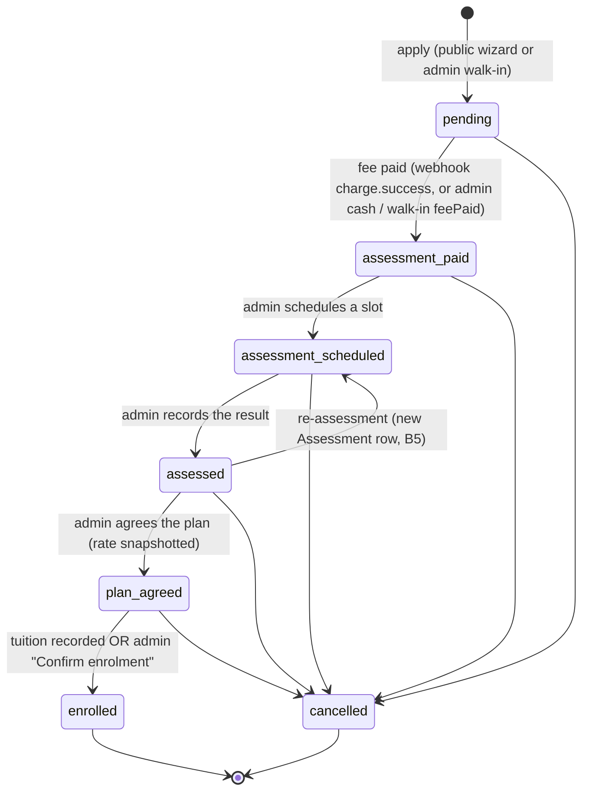
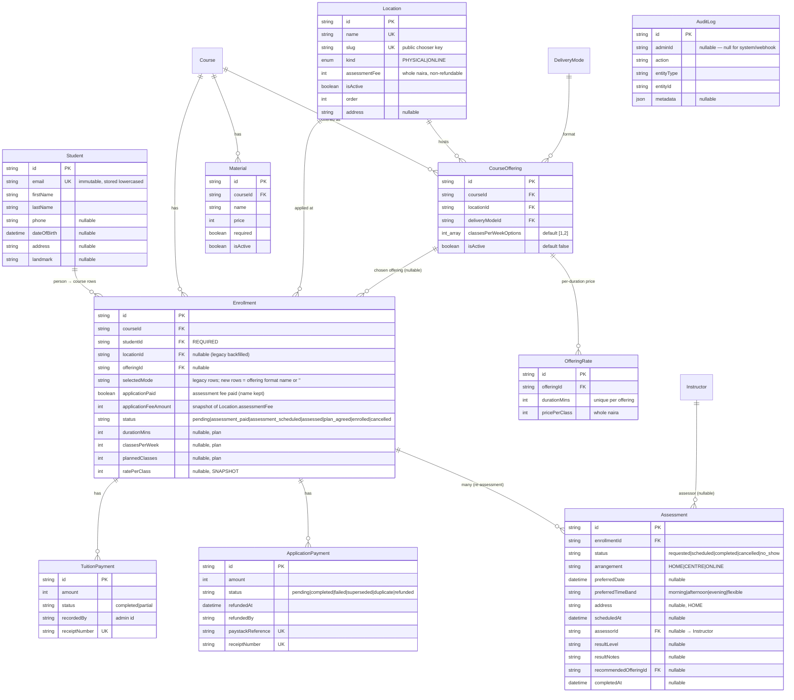

# Banafix — System Blueprint

> **The one document a developer, a designer, and a stakeholder can argue from with the same facts.**
> Every claim is marked with its source so you know how much to trust it.

| Marker | Means | Source |
| --- | --- | --- |
| 🟢 LIVE | Observed on a running system | captured response, real log, DB query |
| 🟡 CODE | Read from source | controller, Prisma schema, enum |
| 🔵 INTENT | Planned, not built | this conversation's requirements |
| ⚠️ UNVERIFIED | Could not be checked | reason stated inline |

- **Mode:** `sync` (current flow re-derived from source) + `init` (planned additions, all 🔵 INTENT)
- **Date:** 2026-11-03 · **Branch:** `feature/assessment-first-admission` @ `713a3b2` (5 commits since `6e96f9c`: `4fe97fc`, `3bfdaf1`, `14eb8c6`, `7845c08`, `713a3b2`) · **Stack:** Next.js 15 (App Router) · Prisma/Postgres · Paystack · Resend · Vercel Blob
- **What changed since the 2026-08-31 sync:** the **assessment-first admission** shipment (Streams 2 + 3 of the 2026-11-03 client meeting). Paying the fee now buys an *assessment*, not enrolment (D6, which supersedes D1). Price, format and location moved off `Course` onto `Location` / `CourseOffering` / `OfferingRate` (D7/D8). Detail: `docs/sop/assessment-first-admission.md`, spec `docs/superpowers/specs/2026-11-03-assessment-first-admission-design.md`, ledger `docs/superpowers/plans/2026-11-03-streams-2-3-assessment-first.md`.

---

## 1. Status snapshot

| Area | State | Notes |
| --- | --- | --- |
| Location-first course browsing | 🟡 Code | `/courses?location=<slug>`, `GET /api/locations`, `lib/offerings.ts`; a course is public at a location only if an offering is *offerable* (active offering ∧ active location ∧ ≥1 rate, B6). Browser checks of the new pages are **not recorded here** — see §10 |
| Enrol wizard (assessment-first) | 🟡 Code | Steps: assessment arrangement → details → consents + pay assessment fee. `POST /api/enrollments` now requires `offeringId` + `arrangement` (B8); legacy `courseId + selectedMode` body is gone |
| Assessment-fee payment (Paystack) | 🟡 Code | Init → redirect → webhook verify → **`pending → assessment_paid`**. Fee = `Location.assessmentFee` (admin data, D11). Webhook behaviour proven against a **local Paystack mock** 🟢 (not real Paystack, §10) |
| **Admission pipeline** (`pending → assessment_paid → assessment_scheduled → assessed → plan_agreed → enrolled`) | 🟡 Code | One guard (`lib/enrollment-status.ts`) + compare-and-set helper (`lib/enrollment-transition.ts`); admin routes for schedule / result / plan / confirm / cancel. Replaces D1 — see §4 |
| `Location`, `CourseOffering`, `OfferingRate`, `Material`, `Assessment` | 🟡 Code | New tables; staged data-preserving migration `20261103150000_assessment_first_admission` proven on an ephemeral Postgres 🟢 (§10). Deprecated `Course` price/format/location/seat columns are **kept, not dropped** (§5, §9) |
| Per-class rates, per duration (45 / 60 min) | 🟡 Code | `OfferingRate`; plan snapshots `Enrollment.ratePerClass` so later rate edits never move a student's price. **Migrated offerings are inactive with no rates**, so every course shows "Enrolment opening soon" until an admin enters rates in `/admin` |
| Admin: locations, offerings matrix + bulk rate, materials | 🟡 Code | `/admin/locations`; course edit gains Offerings + Materials tabs; routes in §6 |
| Admin: enrollment pipeline UI | 🟡 Code | Stage filters + "Assessment & plan" panel (schedule / record + edit result / agree plan / confirm); `/admin/enrollments` split into `components/admin/enrollments/*` |
| Seat counting | ⛔ Retired (D9) | `Course.totalSeats/seatsLeft/unlimitedSeats` kept in the DB, **no longer enforced or decremented anywhere** |
| `Student` entity (canonical person, unique immutable lowercased email) | 🟡 Code | D2 built (unchanged by this shipment). `Enrollment.studentId` FK |
| Admin activity/audit log | 🟡 Code | `AuditLog` + `logAdminAction()` (`lib/audit.ts`), best-effort. Every new admin route writes an audit row (action names in §6); webhook writes `enrollment.assessment_paid` (was `enrollment.enrolled`) |
| Student "application received" ack email | 🟡 Code | `POST /api/enrollments`; copy now says "Assessment Application Received" and the assessment fee |
| Student paid-receipt + PDF | 🟡 Code | Webhook; PDF titled `ASSESSMENT FEE RECEIPT`; helper/type names (`sendApplicationFeeReceipt`, `ApplicationFeeReceiptData`) unchanged — copy-only relabel |
| Admin "new paid assessment application" notice | 🟡 Code | Webhook → `ADMIN_EMAIL`/`SUPPORT_EMAIL` (subject `New paid assessment application: …`) |
| **Email delivery (all of the above)** | ⚠️ **Blocked** | `RESEND_API_KEY` is a placeholder (401); `banafix.com` sender domain unverified — **unchanged by this shipment** |
| Walk-in registration + cash fee | 🟡 Code | `POST /api/admin/enrollments` now picks location → course → optional offering; `feePaid` moves `pending → assessment_paid` (not `enrolled`). See `docs/sop/walk-in-registration.md` |
| Tuition payment (admin-recorded) + student receipt | 🟡 Code | `POST /api/admin/enrollments/[id]/tuition`; on a `plan_agreed` enrollment it also moves it to `enrolled`. Balance: plan rows use `ratePerClass × plannedClasses`; **legacy rows still use `Course.pricing[selectedMode]`** until Stream 5 |
| Migration 2 — drop dormant `Enrollment` identity columns | ❌ **Deferred** | Unchanged: nullable, unread, still in DB and `schema.prisma` |
| Migration 3 — drop deprecated `Course` price/format/location/seat columns | ❌ **Deferred** | New follow-up (staged-migration precedent). Columns now carry DB defaults (B13) so new courses can be created without them |
| Edit student record (admin) | 🟡 Code | `PATCH /api/admin/students/[id]` (email immutable) + edit modal + `student.update` audit; O4 reconciled |
| Parent records + parent↔child mapping | 🟡 Code | `Parent` model + m-n `_ParentChildren`; `/admin/parents` CRUD |
| Instructor roster (reusable, many courses) | 🟡 Code | `Instructor` one-to-many (`Course.instructorId`); `/admin/instructors`. Now also `Assessment.assessorId → Instructor`, and many-to-many `InstructorCourse` (Stream 4) |
| **Scheduling** (Stream 4): instructor availability, `ClassSession`, conflict prevention | 🟡 Code | `InstructorAvailability` (weekday × location × mode), `ClassSession` with `btree_gist` **exclusion constraints** per instructor and per student (active = scheduled/held), generator from the plan + student preferences, audited availability override. Migration `20261103170000_scheduling` verified on an ephemeral Postgres 🟢; concurrent bookings proven on a real DB 🟢 (§10). Detail: `docs/sop/scheduling.md`, FE contract `docs/fe-integration-guide-scheduling.md` |
| Admin: availability editor, `/admin/schedule` timetable, assign / reschedule / mark held-missed-cancelled | 🟡 Code | Week grid (desktop) / agenda (phone); every mutation writes an `AuditLog` row inside its transaction. Some dialogs not browser-checked (§10) |
| Student scheduling preferences | 🟡 Code | `Enrollment.preferredDays` (`mon..sun`), `preferredTimeBands`, `preferredFromTime/ToTime`, `preferredClassesPerWeek`; captured by the wizard and walk-in modal |
| Birthday automation (students + parents) | 🟡 Code | Vercel Cron → `/api/cron/birthdays`; delivery pending real `RESEND_API_KEY` |

---

## 2. System map 🟡

```mermaid
flowchart LR
    subgraph Client
      Visitor["Prospective student<br/>/courses → /enroll"]
      Admin["Admin<br/>/admin"]
    end
    subgraph App["Next.js 15 App Router"]
      PublicAPI["Public API<br/>/api/enrollments, /api/courses, /api/locations"]
      AdminAPI["Admin API (JWT)<br/>/api/admin/*"]
      Webhook["/api/webhooks/paystack"]
      Cron["/api/cron/birthdays"]
    end
    DB[("PostgreSQL<br/>(Prisma)")]
    Paystack["Paystack<br/>payments"]
    Resend["Resend<br/>email"]
    Blob["Vercel Blob<br/>course images"]

    Visitor --> PublicAPI --> DB
    PublicAPI -->|initialize (assessment fee)| Paystack
    Paystack -->|redirect| Visitor
    Paystack -->|charge.success webhook| Webhook --> DB
    Webhook -->|receipt + admin notice| Resend
    PublicAPI -->|ack| Resend
    Admin --> AdminAPI --> DB
    AdminAPI -->|tuition receipt| Resend
    Admin -->|upload| Blob
    Cron -->|daily| DB
    Cron -->|birthday emails| Resend
```

---

## 3. End-to-end workflow — apply → assessment fee → assessment → plan → enrolled 🟡

**Drift from the 2026-08-31 blueprint:** the fee no longer enrols the student. It buys an assessment; admission follows (D6).

```mermaid
sequenceDiagram
    actor S as Student
    participant FE as /courses → /enroll (browser)
    participant API as POST /api/enrollments
    participant PS as Paystack
    participant WH as Webhook
    participant DB as Postgres
    participant M as Resend
    actor A as Admin

    S->>FE: choose location → course → format (offering)
    FE->>API: submit (courseId, offeringId, arrangement, preferred date/band, address if HOME, student info)
    API->>DB: offering must be offerable (active ∧ location active ∧ ≥1 rate) else 400
    API->>DB: upsert Student (by lower(email); existing fields NOT overwritten, O4)
    API->>DB: create Enrollment (locationId, offeringId, status=pending) + Assessment(requested)
    API->>DB: create ApplicationPayment (pending) — amount = Location.assessmentFee
    API->>PS: initialize
    API->>M: "assessment application received" ack (best-effort)
    API-->>FE: authorization_url
    FE->>PS: redirect to checkout
    S->>PS: pay assessment fee (non-refundable)

    par Redirect (cosmetic only)
      PS-->>FE: /enroll/success?reference=…
      FE->>API: GET /api/enrollments/verify
      API-->>FE: status (reads DB / asks Paystack)
    and Webhook (authoritative)
      PS->>WH: charge.success
      WH->>PS: verify(reference)
      WH->>DB: ONE transaction: claim ApplicationPayment (status != completed)<br/>+ Enrollment pending → assessment_paid, applicationPaid=true<br/>(no seat decrement)
      WH->>DB: AuditLog "enrollment.assessment_paid"
      WH->>M: student receipt + PDF; admin "new paid assessment application" notice
    end

    Note over A,DB: after the fee, the student is NOT enrolled — admin drives the stages
    A->>DB: POST …/assessment → assessment_scheduled (slot, assessor, arrangement)
    A->>DB: PATCH …/assessment → assessed (level, notes, recommended offering)
    A->>DB: POST …/plan → plan_agreed (offering, duration, classes/week, planned classes; rate SNAPSHOT)
    A->>DB: POST …/confirm  OR  record tuition on a plan_agreed enrollment → enrolled
    Note over A,DB: tuition recording stays admin-manual; student receipt + AuditLog "tuition.record"
```

**The critical design rule 🟡 (unchanged):** money and state changes happen **only** in the webhook / admin routes. The `/enroll/success` redirect is UX-only. Replays are safe: the webhook claims the `ApplicationPayment` with `updateMany … status != completed`; a count of 0 means already processed and nothing else runs (B12).

**Webhook edge cases 🟡 (all proven on the local mock, §10):** a late `charge.success` for an enrollment that is no longer `pending` (cancelled, or a legacy `enrolled` row) records the payment and sets `applicationPaid=true` but **never moves the status backwards**; audit action becomes `enrollment.fee_paid_unexpected_state` with `statusAtPayment`; for a `cancelled` one no receipt email is sent. A DB error inside the webhook is **rethrown** (route returns 500 so Paystack retries); before this shipment it was swallowed. `charge.failed` never touches the enrollment and can no longer overwrite an already-`completed` payment. The charged amount/currency must equal the `ApplicationPayment` (kobo) or the webhook does not settle (audit `enrollment.fee_amount_mismatch`); an unknown reference leaves a `payment.unmatched_reference` audit row.

**A second money path was removed 🟡:** the unauthenticated manual verify `POST /api/enrollments/[id]` used to write the retired `application_paid` status and decrement seats, and sent no emails or audit. Nothing called it, so it was deleted; the webhook (via `settleAssessmentFee`, `lib/assessment-payment.ts`) is the only settle path. A stale `pending` application is **cancelled, not deleted** (and only after the new payment initialised), when the student re-applies, so a payment still in flight keeps its record.

---

## 4. Enrollment status state machine

**Current (🟡) — assessment-first, owned by `lib/enrollment-status.ts` (`ALLOWED_TRANSITIONS`, unit-tested):**



| Move | Who / what triggers it | Route / code |
| --- | --- | --- |
| `assessment_paid → assessed` | admin "reuse latest assessment" (`POST /api/admin/enrollments/[id]/assessment/reuse`); only meaningful for a student already assessed | route |
| `pending → assessment_paid` | Paystack `charge.success`; admin cash mark-paid; walk-in `feePaid` | `settleAssessmentFee`; `POST /api/admin/enrollments/[id]/mark-paid`; `POST /api/admin/enrollments` |
| `assessment_paid → assessment_scheduled` | Admin sets a slot | `POST …/[id]/assessment` (also walk-in with `scheduleAssessmentAt`) |
| `assessment_scheduled → assessed` | Admin records result | `PATCH …/[id]/assessment` |
| `assessed → assessment_scheduled` | Re-assessment (new `Assessment` row) — **builder addition B5, not in the spec's table** | `POST …/[id]/assessment` |
| `assessed → plan_agreed` | Admin agrees plan | `POST …/[id]/plan` |
| `plan_agreed → enrolled` | Tuition recorded, or audited confirm | `POST …/[id]/tuition`, `POST …/[id]/confirm` |
| any non-terminal `→ cancelled` | Admin | `POST …/[id]/cancel` (never touches payments; fee stays non-refundable) |

`enrolled` and `cancelled` are terminal. `canTransition()` returns false for unknown strings, including the retired `application_paid`. Every writer uses `transitionEnrollment()`, an `updateMany where {id, status: from}` compare-and-set, so two concurrent writers cannot both win; losers get `409 "The enrollment changed while you were editing; refresh and try again"`.

Moves that are **not** status transitions but are allowed by the routes (🟡, beyond the spec): rescheduling an already-`assessment_scheduled` assessment in place; editing a completed result in place (audited with before/after); re-agreeing a `plan_agreed` plan in place (**re-snapshots the current rate** — deliberate, audited as `plan.edit`); retroactive record-only assessments for legacy `enrolled` rows (and `plan_agreed` for schedule). Scheduling a `pending` enrollment is rejected with 400 "The assessment fee must be paid before scheduling".

> **Decision D1 — ⚠️ SUPERSEDED by D6 (2026-11-03).** D1 said paying the registration fee **is** enrollment (webhook wrote `status='enrolled'`, `application_paid` retired). That is now false by design: the fee buys an assessment and admission follows. **Legacy rows are grandfathered** — the migration changes no statuses, so every existing `enrolled` row stays `enrolled` and every `pending` stays `pending`. The fee remains **non-refundable**. The earlier "enrolled/audit write path not live-verified" limitation is replaced by the webhook proof against a local mock (§10); a real Paystack test-mode charge is still **NOT DONE**.

---

## 5. Data model

### 5.1 Current (relevant tables) 🟡



(`Enrollment`'s dormant identity columns and the Parent/Instructor tables are unchanged and omitted from the diagram.)

**`Course` columns now DEPRECATED — kept, not dropped 🟡** (schema comments mark them; dropping is the deferred Migration 3):

| Column | Was | Now |
| --- | --- | --- |
| `pricing` (JSON, per **mode**) | price source | DEPRECATED (D7/D8). DB default `{}`. Still read only for the **legacy tuition balance** (§9) and exposed in `GET /api/enrollments` course select |
| `availableModes` | formats offered | DEPRECATED. DB default `{}` |
| `location` | where taught | DEPRECATED. DB default `''`. Read only as a fallback for legacy enrollments with no `locationId` (admin location filter/label) |
| `duration` | display text | DEPRECATED display text. DB default `''` |
| `totalSeats` / `seatsLeft` / `unlimitedSeats` | capacity | DEPRECATED (D9). Not enforced or decremented; admin seat inputs remain with a "no longer enforced" note |

**Field traps 🟡**
- **Legacy `enrolled` rows have null plan fields** (`offeringId` may be set by the backfill, but `durationMins`, `classesPerWeek`, `plannedClasses`, `ratePerClass` are null) and usually no `Assessment` rows. Emails, receipts, the admin list/panel and the tuition route tolerate that. Legacy `selectedMode` holds a delivery-mode name; for walk-ins with no offering chosen it is `''`.
- `Enrollment.applicationPaid` / `applicationFeeAmount`, table `ApplicationPayment`, and webhook metadata names keep the old "application" wording. "Assessment fee" is **copy-only** in UI, emails and receipts.
- `Enrollment.locationId` is **nullable** (the migration backfills it for every legacy enrollment from `Course.location`, fixture-asserted; it stays nullable in the schema). The assessment fee comes from the offering's `Location`; `mark-paid` prefers the snapshot `applicationFeeAmount` taken at application time, and falls back to the location's current fee only if that is null.
- `Enrollment.ratePerClass` is a **snapshot**: editing an `OfferingRate` never changes an existing plan. Plan routes reject a duration that has no rate on the offering.
- Migrated offerings are `isActive=false` with **no rates**; `POST …/offerings` cannot create an active offering, and `PATCH` refuses to activate one with 0 rates.
- `Student.email` is the unique, immutable, lowercased identity key. On re-enrolment the public `POST /api/enrollments` does **not** overwrite an existing student's fields (`upsert … update: {}`, O4 reconciled with the edit-student module); the admin walk-in route **does** refresh provided fields (admin is authoritative). *The 2026-08-31 text here said re-enrol refreshes fields; that was stale since req #2 shipped.*
- `Enrollment.email`/`firstName`/… dormant identity columns: unchanged (Migration 2 deferred).
- `Enrollment.status` is an untyped `String` (no DB enum/check): the guard is a code guarantee, not a schema-enforced one. Postgres enum is used only for `LocationKind`.
- `TuitionPayment.status` is `completed` (full) or `partial`; the tuition route maps the admin's `paymentType`. No `Assessment`-fee refund flow exists.

### 5.2 Planned additions 🔵

Only seams for later streams remain planned: invoices from `plannedClasses × ratePerClass` + `Material` (Stream 5); a messaging outbox keyed off the status transitions (Stream 7, D10). None are built.

### 5.3 Scheduling tables (Stream 4) 🟡

| Table | Key columns | Notes |
| --- | --- | --- |
| `instructor_courses` | PK `(instructorId, courseId)` | M:N teaches list; backfilled from `Course.instructorId`, which stays the public `/tutors` primary |
| `instructor_availability` | `instructorId`, `weekday` (ISO 1..7), `startMinute`/`endMinute` (Lagos local), `locationId`, `mode` CENTRE/HOME/ONLINE | DB: CHECKs + exclusion constraint (no overlapping windows per instructor and weekday) |
| `class_sessions` | `enrollmentId`, `studentId`, `instructorId`, `locationId?`, `mode`, `startsAt`/`endsAt` (`timestamptz`), `durationMins` 45\|60, `status`, `sequence`, `rescheduledFromId?`, `notes?` | **No money columns (D12).** Composite FK `(enrollmentId, studentId) → enrollments(id, studentId)`. DB: exclusion constraints `class_sessions_instructor_no_overlap` / `class_sessions_student_no_overlap` over `tstzrange(startsAt, endsAt, '[)')` where status in (scheduled, held); partial unique `(enrollmentId, sequence)` where status in (scheduled, held, missed); `endsAt = startsAt + durationMins` CHECK. These constraints are raw SQL in the migration, invisible to Prisma |

**Traps 🟡:** instants are UTC, the academy is Africa/Lagos (UTC+1, no DST); `missed` keeps its class number, `cancelled` frees it; a reschedule makes a **new** session row with the same `sequence`; legacy `preferredDays` may hold `Monday`-style names.

---

## 6. Endpoint index

| Method | Path | Auth | Purpose | Prov |
| --- | --- | --- | --- | --- |
| GET | `/api/locations` | public | Active locations, ordered, physical + ONLINE-kind together: `{locations:[{id,name,slug,kind,assessmentFee}]}` | 🟡 |
| GET | `/api/courses` | public | Published courses. `?location=<slug>` ⇒ only courses with an offerable offering there (unknown slug ⇒ empty list). Each course carries `fromRatePerClass` (min per-class rate among offerable offerings, scoped to `?location`; `null` ⇒ "Enrolment opening soon"). **Removed from payload:** `location`, `modes`, `pricing`, `price`, `totalSeats`, `seatsLeft`, `unlimitedSeats` | 🟡 |
| GET | `/api/courses/[id]` | public | Course detail. `?location=<slug>` scopes `offerings: PublicOffering[]` = `{id, location{id,name,slug,kind,assessmentFee}, format, classesPerWeekOptions, rates[{durationMins,pricePerClass}]}`. **Removed:** `location`, `modes`, `pricing`, `price`, seat fields | 🟡 |
| GET | `/api/instructors` | public | Roster. **Removed from payload:** per-course `location`/`modes`/`pricing`/seat fields, instructor `students`, `location`, `hourlyRate` (all derived from deprecated `Course` columns) | 🟡 |
| POST | `/api/enrollments` | public | Create enrollment + `Assessment{requested}` + init assessment-fee payment + ack email. Body needs `courseId`, `offeringId`, `arrangement` (`HOME`/`CENTRE`/`ONLINE`; HOME needs `address`), optional `preferredDate`, `preferredTimeBand`. 400 `This format is not currently open for enrolment at that location` when not offerable; 400 `You are already enrolled in this course` / `You already have an application for this course in progress` | 🟡 |
| GET | `/api/enrollments` | **JWT (working tree)** / public (HEAD `713a3b2`) | Admin list incl. `location`, `offering{deliveryMode}`, latest `assessment`. ⚠️ the working tree adds `withAuth` and a `limit` clamp (1–200); uncommitted when this was written — **confirm against the merged code** | 🟡 |
| GET | `/api/enrollments/[id]` | **JWT (working tree)** / public (HEAD) | Enrollment detail incl. student PII (same working-tree change as above; nothing in the app called it) | 🟡 |
| GET | `/api/enrollments/verify` | public | Confirm payment for success page (read-only) | 🟡 |
| POST | `/api/admin/application-payments/[id]/refund` | JWT | Records a `duplicate` fee payment as refunded (the refund itself is done in the Paystack dashboard). Audit `application.duplicate_refunded` | 🟡 |
| POST | `/api/admin/enrollments/[id]/assessment/reuse` | JWT | Copies the student's latest completed assessment (or the given `sourceAssessmentId`) and moves `assessment_paid → assessed`. Audit `assessment.reuse` | 🟡 |
| POST | `/api/webhooks/paystack` | signature | `charge.success` → `pending → assessment_paid` + audit + emails | 🟢 mock + sig / ⚠️ real Paystack not exercised (§10) |
| POST | `/api/admin/enrollments` | JWT | Walk-in registration: `locationId` + `courseId` required, `offeringId` optional (must match course + location), `arrangement` default `CENTRE`, `feePaid`, optional `scheduleAssessmentAt` (needs `feePaid`). Audit `enrollment.admin_create` (+ `assessment.schedule`) | 🟡 |
| GET | `/api/admin/enrollments/[id]` | JWT | Everything the "Assessment & plan" panel needs: `{enrollment, assessments[] (newest first), offerings[] with rates}`; legacy rows return empty/null, not an error | 🟡 |
| POST | `/api/admin/enrollments/[id]/mark-paid` | JWT | Cash fee for a `pending` enrollment → `assessment_paid` + completed `ApplicationPayment` in one transaction. 400 `Assessment fee is already marked paid`. Audit `application.cash_paid` | 🟡 |
| POST | `/api/admin/enrollments/[id]/assessment` | JWT | Schedule: `{scheduledAt, arrangement?, assessorId?, address?, landmark?}`. `assessment_paid` → `assessment_scheduled` (reuses the `requested` row); `assessed` → `assessment_scheduled` (new row); `assessment_scheduled` → reschedule in place; `enrolled`/`plan_agreed` → record-only row. Audit `assessment.schedule` / `assessment.reschedule` / `assessment.schedule_record_only` | 🟡 |
| PATCH | `/api/admin/enrollments/[id]/assessment` | JWT | Record result `{resultLevel, resultNotes?, recommendedOfferingId?, assessorId?, completedAt?, assessmentId?}`: `assessment_scheduled` → `assessed`; completed result edited in place (audit `assessment.edit_result` with before/after); legacy `enrolled` → `assessment.result_record_only`. Audit `assessment.result` | 🟡 |
| POST | `/api/admin/enrollments/[id]/plan` | JWT | `{offeringId, durationMins, classesPerWeek, plannedClasses}`: `assessed` → `plan_agreed` (snapshots rate); also edits a `plan_agreed` plan in place. 400 with the builder's error string for an invalid plan. Audit `plan.agree` / `plan.edit` | 🟡 |
| POST | `/api/admin/enrollments/[id]/confirm` | JWT | `plan_agreed` → `enrolled`. Audit `enrollment.confirm` | 🟡 |
| POST | `/api/admin/enrollments/[id]/cancel` | JWT | any non-terminal → `cancelled` (`{reason?}`); payments untouched. Audit `enrollment.cancel` | 🟡 |
| POST | `/api/admin/enrollments/[id]/tuition` | JWT | Record tuition + student receipt + `AuditLog`; on `plan_agreed` also → `enrolled` (audit `enrollment.enrolled_by_tuition`). Requires `applicationPaid` | 🟡 |
| GET | `/api/admin/enrollments/[id]/tuition` | JWT | List tuition payments | 🟡 |
| GET/POST | `/api/admin/locations` | JWT | List (inactive included, with usage counts) / create `{name, kind, assessmentFee, isActive?, order?, address?}`; slug derived, collision-safe. Audit `location.create` | 🟡 |
| GET/PATCH/DELETE | `/api/admin/locations/[id]` | JWT | PATCH keeps the slug on rename unless `regenerateSlug: true` (`location.update`). DELETE refused with 409 while any offering/enrollment references it (`location.delete`) | 🟡 |
| GET/POST | `/api/admin/courses/[id]/offerings` | JWT | List with rates / create `{locationId, deliveryModeId, classesPerWeekOptions?}`; always created inactive; 409 on duplicate course × location × format. Audit `offering.create` | 🟡 |
| PATCH/DELETE | `/api/admin/courses/[id]/offerings/[offeringId]` | JWT | PATCH `{isActive?, classesPerWeekOptions?, rates?}` (rates replace all; activating with 0 rates ⇒ 400). DELETE 409 if enrollments reference it. Audit `offering.update` / `offering.delete` | 🟡 |
| POST | `/api/admin/courses/[id]/offerings/bulk-rate` | JWT | `{durationMins, pricePerClass, offeringIds?, all?: true}` upserts that duration's rate; returns `{count}`. Audit `offering.bulk_rate` | 🟡 |
| GET/POST | `/api/admin/courses/[id]/materials` | JWT | List / create `{name, price, required?, isActive?}`. Audit `material.create` | 🟡 |
| PATCH/DELETE | `/api/admin/courses/[id]/materials/[materialId]` | JWT | Audit `material.update` / `material.delete` | 🟡 |
| GET/PATCH/DELETE etc. | `/api/admin/courses*` | JWT | Course CRUD. `POST` no longer requires `location`/`pricing`/`availableModes` (DB defaults); list `_count.offerings` counts **offerable** offerings only | 🟡 |
| GET/POST | `/api/admin/tuition-payments/[id]/receipt` | JWT | Regenerate/resend tuition receipt | 🟡 |
| GET | `/api/receipts/application-fee/[enrollmentId]` | JWT | Regenerate/resend the **assessment-fee** receipt (route name kept; download filename now `assessment-fee-receipt-<no>.pdf`) | 🟡 |
| GET/PUT | `/api/admin/instructors/[id]/availability` | JWT | Weekly availability; PUT replaces the whole week (`{slots:[{weekday,start,end,locationId,mode}]}`). Audit `availability.update` | 🟢 live (errors) |
| GET | `/api/admin/schedule?from&to&instructorId` | JWT | Timetable read model: sessions, availability, needs-scheduling list | 🟢 live |
| GET/POST | `/api/admin/enrollments/[id]/schedule` | JWT | GET plan + preferences + teaching instructors; POST assign + generate (`dryRun`, `allowPartial`, `overrideAvailability` + `overrideReason`). 409 `INSTRUCTOR_BUSY`/`STUDENT_BUSY` never overridable; 422 `UNPLACEABLE`. Audit `schedule.generate`, `schedule.availability_override` | 🟢 live |
| POST | `/api/admin/sessions/[id]/reschedule` | JWT | New row, same `sequence`, old row `rescheduled`. Audit `session.reschedule` | 🟢 live |
| POST | `/api/admin/sessions/[id]/status` | JWT | held / missed / cancelled / revert. Audit `session.status` | 🟢 live |
| PATCH | `/api/admin/students/[id]`, `/api/admin/parents*`, `/api/admin/instructors*`, `GET /api/cron/birthdays` | JWT / `CRON_SECRET` | Unchanged by this shipment (student edit, parents, roster, birthdays) | 🟡 |

\* D5: public read endpoints for enrollment detail/list were unauthenticated at HEAD `713a3b2`; see §8.

---

## 7. Planned additions — design detail 🔵

Reqs #1–#4 and the audit-log foundation are built (see §1); their design notes live in their SOPs (`docs/sop/tuition-receipts.md`, `student-edit.md`, `parents-module.md`, `birthday-automation.md`). Still planned, from the 2026-11-03 meeting (see `docs/checklist/master-checklist.md`):

- ~~**Stream 4 — Scheduling**~~ built; see §1, §5.3 and `docs/sop/scheduling.md`. Stream 5 joins `ClassSession` on `(enrollmentId, sequence)` for paid-class derivation (D12); Stream 7 wires the `TODO(S7)` hooks in `lib/scheduling/hooks.ts`.
- **Stream 5 — Per-class tuition:** invoices from `plannedClasses × ratePerClass` plus `Material`; online tuition; removes the last reader of `Course.pricing` (legacy tuition balance). May tighten "when does `plan_agreed` become `enrolled`" (today: any tuition payment, or the audited Confirm — a builder's call in the spec).
- **Stream 6/7/8:** parent capture at registration, messaging outbox (D10) consuming the status transitions as triggers, site content.

---

## 8. Open questions / decisions needed

| # | Decision | Status | Resolution |
| --- | --- | --- | --- |
| **D1** | What should `enrolled` mean? | ⚠️ **SUPERSEDED by D6 (2026-11-03)** | Was: paying **is** enrollment (webhook wrote `enrolled`). Now `enrolled` is reached only after assessment + plan (§4). Legacy `enrolled` rows are grandfathered |
| **D2** | What is a "student"? | ✅ DECIDED + BUILT | `Student` entity keyed by unique immutable lowercased email. Migration 2 (drop dormant `Enrollment` identity columns) deferred |
| **D3** | Source of "expected total tuition"? | ✅ Decided, **partly superseded** | `course.pricing[selectedMode]` survives **only for legacy rows**. Rows with a plan use `ratePerClass × plannedClasses` (`planTotal`). Stream 5 replaces both with invoices |
| **D4** | Birthday scheduler? | ✅ DECIDED | Vercel Cron |
| **D5** | Public enrollment read endpoints unauthenticated | 🟡 **Partly closed:** `GET /api/enrollments` and `GET /api/enrollments/[id]` are `withAuth` (commit `e7160eb`); the public manual-verify POST was deleted. Still public: `GET /api/receipts/application-fee/[enrollmentId]` | Review that route |
| **D6** | Does paying the fee enrol the student? | ✅ DECIDED + BUILT | No. The fee buys an **assessment**; admission follows. Supersedes D1. Fee stays non-refundable. Legacy `enrolled` rows stay `enrolled`; legacy `pending` stays `pending` |
| **D7** | Where do price, format and location live? | ✅ DECIDED + BUILT | `CourseOffering` (course × location × format) replaces `Course.pricing/availableModes/location`; the old columns are deprecated, not dropped |
| **D8** | How is price stored? | ✅ DECIDED + BUILT | Per class, per duration: `OfferingRate (offering, durationMins, pricePerClass)`; plan snapshots `Enrollment.ratePerClass` |
| **D9** | Seat counting | ✅ DECIDED + BUILT | Retired. Columns kept, not enforced or decremented anywhere (POST, wizard, webhook, verify route) |
| **D10** | Messaging | ✅ Decided, **not built** | Behind a channel interface; email now, WhatsApp/SMS later (Stream 7) |
| **D11** | Commercial config | ✅ DECIDED + BUILT | Assessment fee per location, offerings, rates, materials are all admin-editable data; `lib/application-fee.ts` (hardcoded tiers) is deleted; `lib/locations.ts` survives only as seed input |

**D12 (2026-11-03, Adebayo): the assessment fee is charged ONCE PER STUDENT** (legacy payments count; covered applications start at `assessment_paid`; a payment that arrives anyway is stored `duplicate` and refunded by hand). **Builder decisions B1–B17** (left open by the spec; recorded in `docs/sop/assessment-first-admission.md`): B1 `Location.slug`, chooser = `?location=<slug>`; B2 `Assessment` uses `preferredDate` + `preferredTimeBand`; B3 `Assessment.address/landmark` for home visits; B4 public enrol creates `Assessment{requested}` with the pending enrollment; B5 `assessed → assessment_scheduled` re-assessment move; B6 "offerable" predicate; B7 walk-in `offeringId` optional; B8 public POST requires `offeringId`; B9 duplicate guard blocks only non-`pending`, non-`cancelled`; B10 `PAYSTACK_BASE_URL` override for the local mock; B11 seat enforcement removed; B12 webhook payment + enrollment move in one transaction; B13 DB defaults on deprecated `Course` NOT NULL columns.

**Open business rule (the client's):** is the assessment fee charged once per student or once per course application? Default until answered: once per application (today's behaviour).

---

## 9. Drift detection

| Claim | Where stated | Reality (source) | Verdict |
| --- | --- | --- | --- |
| **"Once the fee is paid, the student is enrolled" / "paying = enrolled"** | user's earlier mental model; D1; this blueprint 2026-08-31; `docs/sop/student-entity-foundation.md`, `enrollment-emails.md` | `settleAssessmentFee` moves `pending → assessment_paid`; `enrolled` needs a plan + tuition/confirm. 🟡 `lib/assessment-payment.ts`, `lib/enrollment-status.ts` | ❌ **now false, by design (D6)**. Legacy rows stay `enrolled` |
| `Course.pricing` is the price source | schema comment, D3, `tuition-receipts.md` | Public pages and APIs price from `OfferingRate`; `pricing` no longer appears in `GET /api/courses[/id]`. Still read for the **legacy tuition balance** and returned by `GET /api/enrollments` | ❌ no longer the price source; ⚠️ lingering readers until Stream 5 |
| `Course.location` / `availableModes` identify location and formats | `lib/locations.ts`, old filters | Replaced by `Enrollment.locationId` / `CourseOffering`; remaining use is a fallback for legacy enrollments with no `locationId` (admin location filter/label) | ❌ deprecated |
| Seats are counted and capped | old POST, wizard, webhook | No code decrements or enforces `seatsLeft` (D9). Admin seat inputs remain, with a "no longer enforced" note | ❌ **retired** |
| Admin courses list "Seats Utilization" stat is meaningful | `app/admin/courses/page.tsx` | Still computed from `totalSeats − seatsLeft`, which nothing updates any more, so it is a stale vanity number | ⚠️ drift (display only; remove with Migration 3) |
| `lib/application-fee.ts` computes the fee | old blueprint §3 "location-based fee" | File deleted; fee is `Location.assessmentFee` | ❌ retired (D11) |
| Legacy `enrolled` rows look like new ones | — | They have **null** `durationMins/classesPerWeek/plannedClasses/ratePerClass` and usually no `Assessment`; the panel opens read-only with an optional "add assessment record" | ⚠️ by design; every consumer must be null-safe |
| **Tuition balance for legacy rows** | `tuition-receipts.md` | Tuition route: plan rows ⇒ `planTotal(ratePerClass, plannedClasses)`; otherwise `Course.pricing[selectedMode]` (omitted when absent, e.g. walk-ins with `selectedMode ''`) | ⚠️ unchanged for legacy until Stream 5 |
| "Admin approval gate after payment is not needed" | D1 | The pipeline is exactly an admin-driven gate (schedule → result → plan → confirm) | ❌ superseded |
| "Re-enroll refreshes the student's fields (O4)" | this blueprint §5 (2026-08-31) | Public re-enrol does **not** overwrite (`update: {}`); walk-in does | ✅ corrected here (stale since req #2) |
| Enrollment emails are sent | SOP `enrollment-emails.md` | code sends 🟡 but `RESEND_API_KEY` is a placeholder → 401 🟢 | ⚠️ wired, **not delivering** — pre-existing, unchanged |
| Admin status dropdown changes status | reasonable assumption | It is a **filter**; status changes happen through the stage routes above | ✅ the pipeline routes are the setters now |
| The `assessment_paid` DB write path is proven | — | Proven via the local Paystack **mock** + scratch DB; **not** via a real Paystack test-mode charge | ⚠️ **honest gap** |
| `charge.failed` is harmless to a paid payment | plan Review Focus 2 | Review found `handleChargeFailed` overwrote `ApplicationPayment` unconditionally; fixed to `updateMany where status='pending'` 🟡 + E2E case | ✅ fixed in the review pass |
| Plan said the schedule route would create a standalone assessment for legacy `pending` rows | plan T2 | Code returns 400 for `pending` (fee must be paid first); record-only creation is for `enrolled`/`plan_agreed` | ✅ code is stricter than the plan |

---

## 10. Verification table

| Behaviour | How checked | Provenance |
| --- | --- | --- |
| **Migration `20261103150000_assessment_first_admission` on ephemeral Postgres with a legacy fixture** — zero row loss in every legacy table, statuses unchanged, every enrollment with a location text has `locationId`, all offerings inactive with 0 rates, fee tiers per location, orphan mode skipped, deprecated `Course` columns untouched, no schema drift | `scripts/verify-migration.sh`: 33 assertions, all pass (incl. slug collisions, non-ASCII/empty names, empty location, legacy `application_paid`, case-variant mode names) | 🟢 LIVE (scratch DB) |
| **Webhook → `assessment_paid`** incl. replay, 3 concurrent deliveries, cancelled enrollment, legacy `enrolled` row, `charge.failed` (and late failed after success), amount mismatch, unmatched reference; exactly one transition and one audit row; `seatsLeft` unchanged | `scripts/test-webhook.mjs` with `WEBHOOK_E2E=1` against the ephemeral DB and `scripts/mock-paystack.mjs` (`PAYSTACK_BASE_URL` override) | 🟢 LIVE (**mock — NOT real Paystack**) |
| Webhook accepts valid signature (200), rejects forged (400) | `npm run test:webhook` against live dev server | 🟢 LIVE (earlier sync; default mode unchanged) |
| Unit tests: guard table, rate/plan snapshot, fee lookup, offerable predicate, admin validation, CAS helper | `npm test` (Vitest) → **61 passing** | 🟢 LIVE |
| Whole-repo type safety / production build | `npx tsc --noEmit`, `npx next build` (run per the ledger at commit time) | 🟡 CODE — re-run on the pushed head before claiming |
| Public wizard, location chooser, "Enrolment opening soon", admin locations/offerings/pipeline UI at 375px and 1280px | browser checks planned in the ledger; no captures referenced here | 🟡 (not confirmed in this doc) |
| Public `POST /api/enrollments` against a non-offerable / offerable offering, fee follows `Location.assessmentFee` | read `app/api/enrollments/route.ts` | 🟡 CODE |
| Admin schedule / result / plan / confirm / cancel routes end to end | read routes + guard unit tests; no recorded HTTP run | 🟡 CODE |
| **Real Paystack test-mode charge** (webhook with a real reference, receipt/ack emails) | — | ⚠️ **NOT DONE** |
| Email delivery | send functions read; delivery blocked on Resend key (pre-existing) | 🟡 CODE / ⚠️ UNVERIFIED |
| Migration 2 (drop dormant `Enrollment` identity columns) / Migration 3 (drop deprecated `Course` columns) | not built | 🔵 INTENT (deferred) |
| **Scheduling migration `20261103170000_scheduling`** on ephemeral Postgres with the legacy fixture: zero row loss, backfill, exclusion/CHECK/partial-unique behaviour in raw SQL, no schema drift | `scripts/verify-scheduling-migration.sh`: 40 assertions pass | 🟢 LIVE (scratch DB) |
| **Concurrent bookings cannot double-book**: 10-way instructor race, 10 racing plans, student race, reschedule vs booking race; override audited and never bypasses a conflict | `scripts/test-scheduling-db.sh`: 21 real-Postgres tests (3 runs stable) | 🟢 LIVE (scratch DB, direct connection; **not** via Prisma Accelerate) |
| Scheduling admin API incl. conflict 409 / 422 / validation errors | `scripts/dev/capture-scheduling.sh`: 22 captures in `docs/captures/scheduling/` | 🟢 LIVE |
| Timetable, assign flow, wizard preference block (1280px, 375px agenda) | browser on a scratch DB | 🟢 LIVE; availability editor / reschedule / status dialogs / walk-in preferences 🟡 CODE |
| Streams 5–8 | not built | 🔵 INTENT |

---

## 11. What is NOT built (so a diagram is not mistaken for a shipped feature)

- A **real Paystack test-mode charge** has not been run against this code (only the local mock).
- **Browser verification** of the new public and admin flows is not recorded in this document.
- Migration 2 (dormant `Enrollment` identity columns) and **Migration 3** (deprecated `Course` price/format/location/seat columns) — both deferred.
- **Rates are not entered:** all migrated offerings are inactive with no rates, so every course shows "Enrolment opening soon" until an admin sets rates (no pricing data came from John yet).
- Notifications for scheduled/rescheduled classes (Stream 7 hooks are no-ops); a student-facing schedule view; travel-time between locations; tuition invoicing, online tuition, materials in billing (Stream 5); parent capture at registration (Stream 6); messaging providers, WhatsApp, feedback (Stream 7, D10); site content (Stream 8).
- A student login/dashboard, refunds, coupons. Policy text still contradicts the non-refundable fee (refund schedule in `components/site/enroll/policy-dialog.tsx`; `/policies` dashboard/PayPal/instalment claims) — deliberately **not edited** here, needs the client's review.
- Per-student vs per-application fee rule (open business question, §8).
- `GET /api/receipts/application-fee/[enrollmentId]` is still unauthenticated (pre-existing); the webhook cannot detect a cash fee recorded while a Paystack charge is in flight (double fee needs an admin refund decision).
- **Actual email delivery** (blocked on a real `RESEND_API_KEY` + verified sender domain — pre-existing).

---

_Authoritative source: this file. The published Artifact and the checklist (`docs/checklist/`) are regenerated from it — edit here first._
